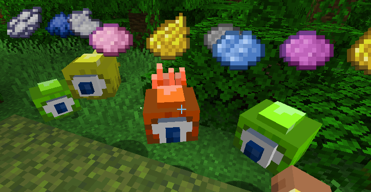
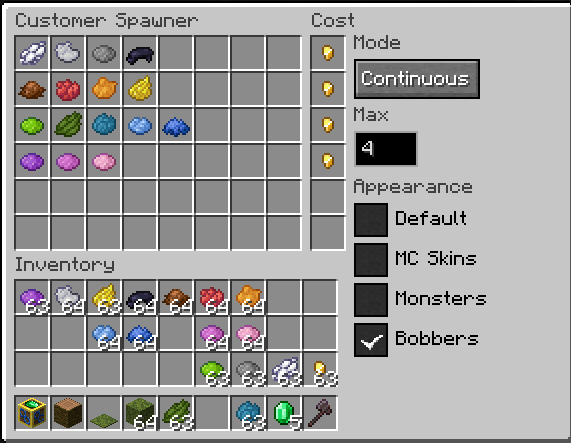

# Example Customers Appearance Mod

This project is a tutorial and an example for creating an Appearance mod for the
Minecraft Customers mod:

* Github - https://github.com/vikingkittensgames/mc-mod-customers
* CurseForge - https://www.curseforge.com/minecraft/mc-mods/customers
* Modrinth - https://modrinth.com/mod/customers

## Appearances Overview

See [Customers documentation](https://github.com/vikingkittensgames/mc-mod-customers#appearances)

This tutorial builds the **Bobbers** appearance included in this project. Bobbers
replace normal, impatient, and casual Customers with floating custom models whose
tentacles move independently.



## Step 1 - Add Customers as a Gradle Dependency

Add the CurseForge Maven repository to the `repositories` block in
`build.gradle`:

[build.gradle](build.gradle#L20)

```groovy
repositories {
    exclusiveContent {
        forRepository {
            maven {
                name = "CurseForge"
                url = "https://minecraft.curseforge.com/api/maven/"
                metadataSources {
                    artifact()
                }
            }
        }
        filter {
            includeGroup "customers"
        }
    }
}
```

CurseForge derives Maven coordinates from the uploaded filename. For
`customers-neoforge-1.21.1-1.6.1.jar`, use `customers` as the group,
`customers-neoforge` as the artifact, `1.21.1` as the Maven version, and `1.6.1`
as the classifier:

```groovy
dependencies {
    compileOnly "customers:customers-neoforge:1.21.1:1.6.1"
}
```

`compileOnly` makes the Customers API available to the compiler without bundling
Customers into your mod or automatically adding it to the development runtime.
Install the Customers JAR in your development run directory's `mods` folder, just
as a player installs it in a Minecraft instance.

CurseForge does not provide a POM for this filename-derived artifact, so
`metadataSources { artifact() }` tells Gradle to resolve the JAR directly.

## Step 2 - Declare Customers as a Required Mod

Add a required dependency to
`src/main/templates/META-INF/neoforge.mods.toml`:

[neoforge.mods.toml](src/main/templates/META-INF/neoforge.mods.toml#L55)

```toml
[[dependencies.${mod_id}]]
    modId="customers"
    type="required"
    reason="This mod adds a Customers appearance."
    versionRange="[1.6.1,)"
    ordering="AFTER"
    side="BOTH"
```

The common appearance definition is needed on both logical sides. Models and
renderers belong in client-only packages.

## Step 3 - Your Appearance Specific Implementation Pieces

This will be different for your Appearance implementation, but for this example
we have a custom model that supports some variation and some textures.

* [BobberModel.java](src/main/java/com/example/customers/appearance/client/BobberModel.java#L1)
* [bobber-customer-normal.png](src/main/resources/assets/customersappearanceexample/textures/entity/bobber-customer-normal.png)
* [bobber-customer-impatient.png](src/main/resources/assets/customersappearanceexample/textures/entity/bobber-customer-impatient.png)
* [bobber-customer-casual.png](src/main/resources/assets/customersappearanceexample/textures/entity/bobber-customer-casual.png)

`BobberModel.Variant`  is used to adjust the model and the texture used for the
different Customers Villager variants.

## Step 4 - Define the Customers Appearance

Implement `CustomersVillagerAppearance` in code that is safe to load on both
the client and a dedicated server. `BobberAppearance` supplies the stable
`customersappearanceexample:bobbers` ID, the translated name shown in spawner
UIs, and limits Bobbers to Customers because this example has no Supplier model.

Returning `null` from an optional sound method tells Customers to retain its
default Villager sound. Bobbers does not override sounds, so it only needs
`getName()` and `isApplicable()`.

[BobberAppearance.java](src/main/java/com/example/customers/appearance/BobberAppearance.java#L10)

```java
public final class BobberAppearance
        implements CustomersVillagerAppearance {
    public static final ResourceLocation ID =
            ResourceLocation.fromNamespaceAndPath(
                    CustomersAppearanceExample.MODID,
                    bobbers
            );

    @Override
    public Component getName() {
        return Component.translatable(
                appearance.customersappearanceexample.bobbers
        );
    }

    @Override
    public boolean isApplicable(CustomersVillager villager) {
        return villager.getCustomersVillagerType()
                != CustomersVillagerType.SUPPLIER;
    }
}
```

## Step 5 - Register the Customers Appearance

Handle NeoForge's `RegisterEvent` and register the appearance in
`CustomersVillagerAppearance.APPEARANCE_REGISTRY_KEY`. The example does this in
`BobberAppearanceEvents`, which is automatically subscribed to the mod event
bus. The appearance ID registered here must be the same ID used by the
client-side appearance registration.

[BobberAppearanceEvents.java](src/main/java/com/example/customers/appearance/BobberAppearanceEvents.java#L9)

```java
@EventBusSubscriber(modid = CustomersAppearanceExample.MODID)
public final class BobberAppearanceEvents {
    private BobberAppearanceEvents() {}

    @SubscribeEvent
    public static void registerAppearances(RegisterEvent event) {
        event.register(
                CustomersVillagerAppearance.APPEARANCE_REGISTRY_KEY,
                registry -> registry.register(
                        BobberAppearance.ID,
                        new BobberAppearance()
                )
        );
    }
}
```

## Step 6 - Provide the Client Side Appearance Pieces

Implement `CustomersVillagerClientAppearance` to select the renderer for each
villager. Bobbers maps the persisted Customer type to a `BobberModel.Variant`,
then returns the renderer built for that variant.

[BobberClientAppearance.java](src/main/java/com/example/customers/appearance/client/BobberClientAppearance.java#L13)

```java
public final class BobberClientAppearance
        implements CustomersVillagerClientAppearance {
    private final Map<BobberModel.Variant, BobberRenderer>
            renderers = new EnumMap<>(BobberModel.Variant.class);

    public BobberClientAppearance(
            EntityRendererProvider.Context context,
            Map<BobberModel.Variant, ModelLayerLocation> modelLayers
    ) {
        for (BobberModel.Variant variant :
                BobberModel.Variant.values()) {
            renderers.put(
                    variant,
                    new BobberRenderer(
                            context,
                            modelLayers.get(variant),
                            variant
                    )
            );
        }
    }

    @Override
    public MobRenderer<?, ?> getRenderer(CustomersVillager villager) {
        return renderers.get(BobberModel.Variant.fromType(
                villager.getCustomersVillagerType()
        ));
    }
}
```

Your renderer is going to be specific to your appearance.

[BobberRenderer.java](src/main/java/com/example/customers/appearance/client/BobberRenderer.java#L11)

## Step 7 - Register the Client Pieces

During the renderer-registration event, associate the same appearance ID registered in
Step 5 with the client appearance factory.

[BobberClientEvents.java](src/main/java/com/example/customers/appearance/client/BobberClientEvents.java#L18)

```java
@EventBusSubscriber(
        modid = CustomersAppearanceExample.MODID,
        value = Dist.CLIENT
)
public final class BobberClientEvents {
    @SubscribeEvent
    public static void registerAppearance(
            EntityRenderersEvent.RegisterRenderers event
    ) {
        CustomersVillagerClientAppearances.register(
                BobberAppearance.ID,
                context -> new BobberClientAppearance(
                        context,
                        MODEL_LAYERS
                )
        );
    }
}
```

## Step 8 - Appearance Sounds

An appearance can override ambient, hurt, death, step, yes, and no sounds.
The yes sound is used for successful trades and valid trade input. The no sound
is used for invalid trade input. Add each OGG file beneath your namespace's
`sounds` asset directory. Bobbers provides:

- [bobber-ambient.ogg](src/main/resources/assets/customersappearanceexample/sounds/bobber-ambient.ogg)
- [bobber-hurt.ogg](src/main/resources/assets/customersappearanceexample/sounds/bobber-hurt.ogg)
- [bobber-death.ogg](src/main/resources/assets/customersappearanceexample/sounds/bobber-death.ogg)
- [bobber-step.ogg](src/main/resources/assets/customersappearanceexample/sounds/bobber-step.ogg)
- [bobber-yes.ogg](src/main/resources/assets/customersappearanceexample/sounds/bobber-yes.ogg)
- [bobber-no.ogg](src/main/resources/assets/customersappearanceexample/sounds/bobber-no.ogg)

Declare the sound event IDs in
[sounds.json](src/main/resources/assets/customersappearanceexample/sounds.json#L1).
Each `sounds` entry points to an OGG path without the `.ogg` extension:

```json
{
  "bobber_ambient": {
    "sounds": [
      "customersappearanceexample:bobber-ambient"
    ]
  },
  "bobber_death": {
    "sounds": [
      "customersappearanceexample:bobber-death"
    ]
  },
  "bobber_hurt": {
    "sounds": [
      "customersappearanceexample:bobber-hurt"
    ]
  },
  "bobber_no": {
    "sounds": [
      "customersappearanceexample:bobber-no"
    ]
  },
  "bobber_step": {
    "sounds": [
      "customersappearanceexample:bobber-step"
    ]
  },
  "bobber_yes": {
    "sounds": [
      "customersappearanceexample:bobber-yes"
    ]
  }
}
```

Create `SoundEvent` values using the IDs from `sounds.json`, then return them
from the corresponding appearance methods in
[BobberAppearance.java](src/main/java/com/example/customers/appearance/BobberAppearance.java#L18):

```java
private static final SoundEvent AMBIENT_SOUND =
        sound("bobber_ambient");
private static final SoundEvent HURT_SOUND =
        sound("bobber_hurt");
private static final SoundEvent DEATH_SOUND =
        sound("bobber_death");
private static final SoundEvent STEP_SOUND =
        sound("bobber_step");
private static final SoundEvent YES_SOUND =
        sound("bobber_yes");
private static final SoundEvent NO_SOUND =
        sound("bobber_no");

@Override
public SoundEvent getAmbientSound(CustomersVillager villager) {
    return AMBIENT_SOUND;
}

@Override
public SoundEvent getHurtSound(CustomersVillager villager) {
    return HURT_SOUND;
}

@Override
public SoundEvent getDeathSound(CustomersVillager villager) {
    return DEATH_SOUND;
}

@Override
public SoundEvent getStepSound(CustomersVillager villager) {
    return STEP_SOUND;
}

@Override
public SoundEvent getYesSound(CustomersVillager villager) {
    return YES_SOUND;
}

@Override
public SoundEvent getNoSound(CustomersVillager villager) {
    return NO_SOUND;
}

private static SoundEvent sound(String path) {
    return SoundEvent.createVariableRangeEvent(
            ResourceLocation.fromNamespaceAndPath(
                    CustomersAppearanceExample.MODID,
                    path
            )
    );
}
```

Your implementation may provide any subset of these sounds. Leave a method
unimplemented, or return `null`, to retain the default Villager sound for that
action.

## Step 9 - Add the Appearance Name

Add the translation key returned by `BobberAppearance.getName()` to your
language file. This is the name Customers displays beside the appearance
checkbox in Customer and Supplier Spawner screens.

[en_us.json](src/main/resources/assets/customersappearanceexample/lang/en_us.json#L1)

```json
{
  "appearance.customersappearanceexample.bobbers": "Bobbers"
}
```

## That's it!

Package up your Customers Appearance mod and install it with the Customers mod
and you should be able to select your new appearance from the spawner block UIs.


